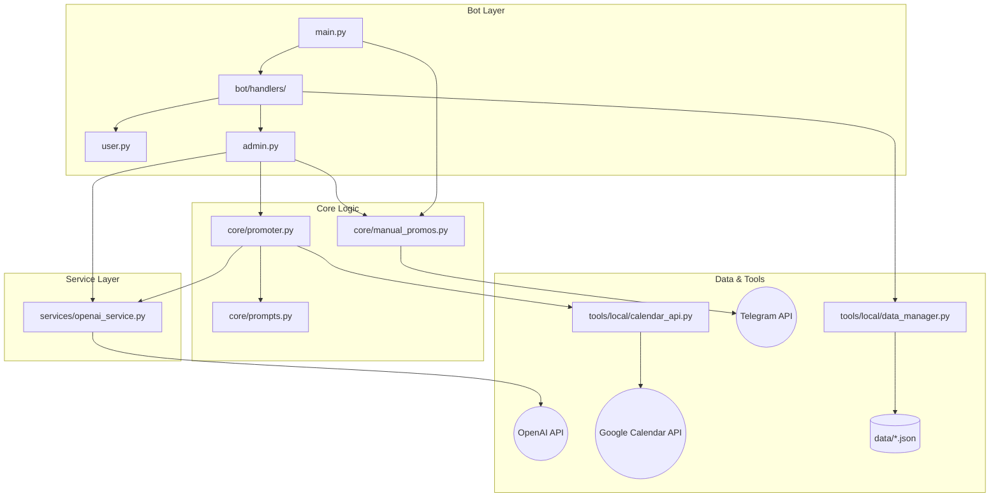

# BTC GDL Message Bot - Architecture Map

## Overview
The bot is built with a modular architecture in Python, following a **Dispatcher-Service-Tool** pattern. It uses natural language processing to bridge the gap between community management and Google Calendar.

## File Map

### Component Details

### 1. **Bot Layer (`main.py`, `bot/`)**
- **`main.py`**: The entry point. Initializes the `Application`, registers all command and message handlers, and starts background jobs for calendar, coffee-host, and manual-promo reminders.
- **`bot/handlers/user.py`**: Logic for public subscribers (Menu, Events list, Start).
- **`bot/handlers/admin.py`**: The complex state machine for community managers. Handles text/voice intent detection, draft refinement, and event orchestration.

### 2. **Core Layer (`core/`)**
- **`core/promoter.py`**: The "brain" of the automated marketing. It polls the calendar, detects new events, and initiates the "draft -> refine -> publish" workflow.
- **`core/manual_promos.py`**: Persists manually uploaded flyers and captions, then delivers confirmed promos to subscribers at the configured reminder thresholds with per-subscriber deduplication.
- **`core/prompts.py`**: Central repository for AI personas and system instructions (Intent detection, Copywriting, GPT Image flyers).

### 3. **Service Layer (`services/`)**
- **`services/openai_service.py`**: Abstracted wrapper for OpenAI. Handles GPT-4o text generation, Whisper transcription, OpenAI TTS-1 speech synthesis, and image generation.

### 4. **Tools & Data Layer (`tools/`, `data/`)**
- **`tools/local/calendar_api.py`**: Low-level wrapper for Google Calendar v3. Handles OAuth2/Service Account auth and CRUD operations on events.
- **`tools/local/data_manager.py`**: Manages persistent JSON storage with atomic writes to prevent data corruption.
- **`data/`**: Storage for subscribers, reminder rules, log history, staged drafts, coffee-host assignments, and manual event promos.

## Design Principles
- **Natural Language First:** Prioritizes voice notes and plain chat over rigid slash commands.
- **Resilient Polling:** Uses a robust JobQueue and persisted delivery state to ensure reminders can resume after a restart.
- **Context Preservation:** Staged drafts and pending promotions are saved to disk, allowing the admin to finish a task hours later.
- **Surgical Logging:** Structured logs for tracing AI decisions and API interactions.
